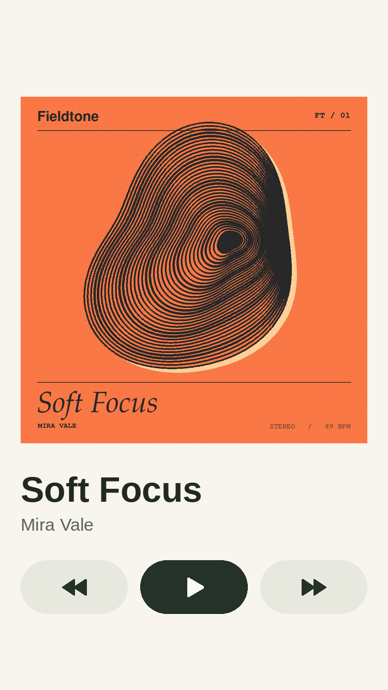
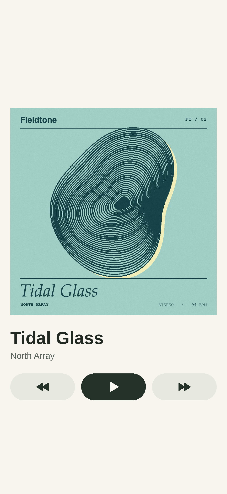

# Fieldtone

Одноэкранный музыкальный плеер для iPhone, написанный на Swift и UIKit. В комплекте 10 инструментальных композиций и 10 обложек. Музыка воспроизводится офлайн через AVAudioPlayer.

## Запуск

1. Откройте `Fieldtone.xcodeproj` в Xcode 16 или новее.
2. Выберите схему **Fieldtone** и симулятор iPhone с iOS 16 или новее.
3. Нажмите **⌘R**. Первая композиция — *Soft Focus* в исполнении Mira Vale. Нажмите центральную кнопку, чтобы начать воспроизведение.

## Экраны и демонстрация

В архиве показаны превью по разметке storyboard. PNG и ролик отрисованы вне iOS Simulator.

| iPhone SE (3-го поколения) | iPhone 16 Pro Max |
| --- | --- |
|  |  |

[Посмотреть демонстрацию, 24 секунды](Media/Preview/demo.mp4)

В ролике плеер начинает и приостанавливает воспроизведение. Кнопка «Назад» переключает первый трек на десятый во время паузы. Затем кнопка «Вперёд» возвращает с десятого трека на первый уже во время воспроизведения. На обложках указан номер композиции в плейлисте.

Чтобы получить нативные снимки и запись, создайте оба указанных симулятора в Xcode и запустите из папки проекта:

```sh
./Scripts/capture.sh
```

Скрипт собирает приложение, делает снимки через `simctl`, записывает нажатия UI-теста на iPhone 16 Pro Max и обновляет ссылки выше. Если симуляторы переименованы, передайте скрипту их UDID в порядке SE, затем Pro Max.

## Как устроен плеер

- Вся разметка экрана находится в `Fieldtone/Base.lproj/Main.storyboard`. Основной вертикальный стек выровнен по центру безопасной области и имеет боковые отступы по 20 pt. Четвёртое ограничение сохраняет квадратную форму обложки.
- Внутри основного стека один вертикальный стек объединяет название и исполнителя с интервалом 4 pt. Горизонтальный стек делит ширину поровну между тремя кнопками с интервалом 12 pt. Внутренние отступы кнопок увеличивают область нажатия.
- `TrackLibrary.swift` содержит модель `Track` и упорядоченный список. Имена ресурсов связывают композиции с M4A в папке `Audio` и обложками в `Assets.xcassets`.
- `PlayerViewController.swift` хранит индекс трека и экземпляр `AVAudioPlayer`. Состояние воспроизведения берётся из `isPlaying`. При паузе сохраняется позиция. Переключение открывает выбранный трек с начала и сохраняет состояние «играет» или «пауза».
- После окончания композиции делегат запускает следующую. Оба направления переключения работают по кругу. При ошибке чтения файла плеер выводит сообщение в консоль Xcode, а кнопки переключения остаются доступными.

UI-тесты запускаются сочетанием **⌘U**. Они проверяют паузу и воспроизведение, переключение в обоих состояниях, переходы через границы списка и автоматический переход после окончания первой композиции.

## Музыка и обложки

Все десять композиций синтезированы для Fieldtone. Обложки созданы специально для этого проекта, имена исполнителей — творческие псевдонимы. Аудиофайлы и изображения можно использовать, изменять и распространять вместе с проектом без выплаты роялти.
